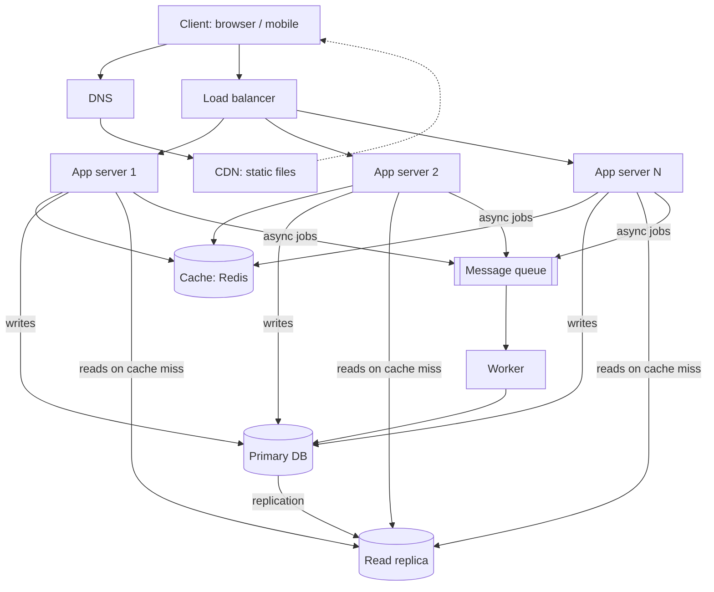

# QuickNotes Architecture

## Requirements

**Functional**
- Register / log in
- Create, read, update and delete notes
- Tag notes and filter by tag
- List a user's notes (paginated)

**Non-functional**
- Availability: 99.9% (no single point of failure)
- Latency: p95 under 300 ms for reads, under 500 ms for writes
- Scalability: 1 million users, able to grow 10x
- Durability: no note lost once acknowledged (backups + replication)
- Security: HTTPS, hashed passwords, per-user access control
- Consistency: read-your-own-writes for the author; slight staleness acceptable elsewhere

## Load estimate (1 million users)

Assumptions: 1M users, 20 note reads and 2 note writes per user per day, peak = 3x average, average note about 1 KB.

| Metric | Calculation | Result |
|--------|-------------|--------|
| Reads per day | 1M × 20 | 20M |
| Reads per second | 20M / 86,400 ≈ 230 avg | **~230 avg, ~700 peak** |
| Writes per day | 1M × 2 | 2M |
| Writes per second | 2M / 86,400 ≈ 23 avg | **~23 avg, ~70 peak** |
| Storage per year | 2M × 365 × 1 KB ≈ 730 GB | **~0.75 TB raw, ~2 TB with indexes and replica overhead** |

Read:write ratio is about 10:1, so caching and read replicas pay off.

## Architecture diagram

## Components

- **Client:** the browser or mobile app that users interact with and that calls the REST API.
- **DNS:** translates `api.quicknotes.example` into the load balancer's address so users never need an IP.
- **CDN:** serves static files (HTML, CSS, JS, images) from servers near the user, cutting latency and load on our servers.
- **Load balancer:** spreads requests across app servers and stops sending traffic to unhealthy ones.
- **App servers (2+):** stateless servers running the API logic, so we can add more to scale horizontally.
- **Cache (Redis):** keeps hot data (recent note lists) in memory so most reads never touch the database.
- **Primary database:** the single source of truth that accepts all writes.
- **Read replica:** a copy of the primary that serves read queries, offloading the primary and acting as a failover candidate.
- **Queue:** buffers background tasks (e.g. search indexing, email, cache warming) so slow work does not delay the user's response.
- **Worker:** consumes queue messages and performs those tasks independently of the API servers.

## Request flows

### GET /notes
1. Client resolves the API domain via DNS and sends HTTPS `GET /notes?limit=10` with its token.
2. The load balancer forwards it to a healthy app server.
3. The app server validates the token and identifies the user.
4. It checks the cache for key `notes:user:42:page:1`.
5. **Cache hit:** return the cached JSON (200).
6. **Cache miss:** query the read replica (`WHERE user_id = 42 ORDER BY created_at DESC LIMIT 10`), store the result in the cache with a short TTL (e.g. 60 s), then return it (200).

### POST /notes
1. Client sends HTTPS `POST /notes` with JSON body and token.
2. The load balancer forwards it to an app server.
3. The app server authenticates the user and validates the body (title required, at most 100 chars); invalid input gets 400.
4. It inserts the note (and tag links) in one transaction on the **primary** database.
5. It invalidates the user's cached note-list keys so the next read is fresh.
6. It publishes an event (e.g. "note.created") to the queue.
7. It returns `201 Created` with the new note.
8. A worker consumes the event later and updates the search index / sends notifications; the user does not wait for it.

## Trade-offs

1. **Cache vs consistency:** caching makes reads fast and cheap, but cached lists can be briefly stale. We accept up to 60 s staleness for other readers and invalidate on write so the author sees their change immediately.
2. **Read replica vs freshness:** replication is asynchronous, so a replica can lag by milliseconds to seconds. We gain read capacity but may read slightly old data; reads straight after a write can be sent to the primary.
3. **SQL vs NoSQL:** relational integrity and JOINs cost us easy horizontal write scaling; at ~70 writes/s peak this is not a problem, and sharding by `user_id` is the later escape hatch.
4. **Queue (async) vs simplicity:** background work makes responses faster but adds a component to run and monitor, and tasks must be idempotent.

## Avoiding single points of failure

- **DNS:** use a managed DNS provider with multiple name servers.
- **CDN:** globally distributed by design.
- **Load balancer:** run a redundant pair (active/passive or managed multi-AZ LB).
- **App servers:** stateless, at least two in different availability zones; the LB removes failed ones.
- **Cache:** Redis with a replica and automatic failover; the app falls back to the database if the cache is down.
- **Database:** primary with a read replica that can be promoted automatically; daily backups and point-in-time recovery.
- **Queue and workers:** a replicated/managed queue, multiple worker instances, retries and a dead-letter queue.